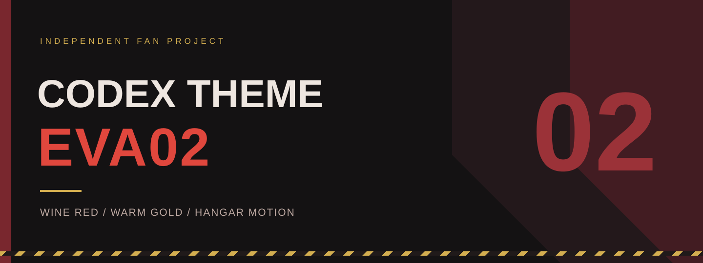
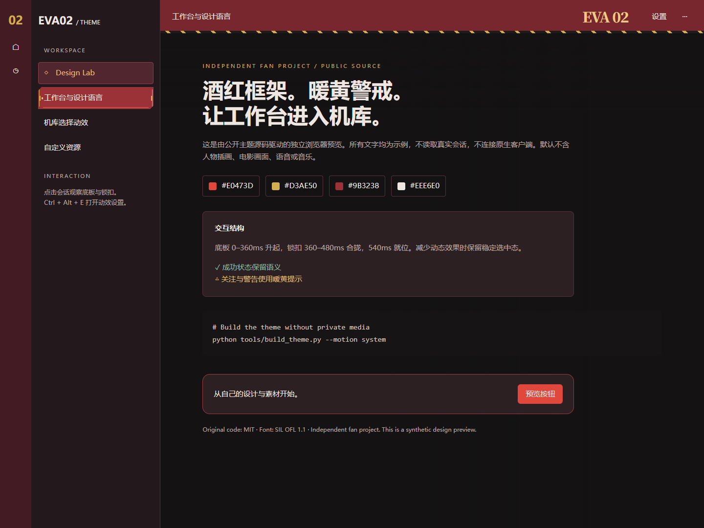

<p align="center"></p>

# codex-theme-EVA02

**把工作台带进 EVA-02 的机库。**

一个面向 **Windows Codex 桌面客户端**的独立同人主题工程：以酒红框架、暖黄警戒、暖白正文和机械锁定动效，重新组织日常编程界面的视觉层次。

项目包含工作台主题、启动演出与原生启动器源码，以及安装、升级和资源构建工具。作者：**lilin.**

> **公开版本说明**：本仓库开放原创代码，并提供无需电影、人物插画或音频素材的主题预览。个人实装版使用过的电影片段、官方插画、音乐、语音及包含这些素材的安装包均未随仓库发布。克隆仓库可直接构建浏览器主题预览；完整原生启动演出需要自行准备具有适当使用权限的素材。详见[素材与免责声明](#素材版权与免责声明)和[完整构建说明](docs/BUILD.md)。



*上图为公开代码驱动的合成预览，包含示例文本；不是真实会话截图。*

## 做了什么

### EVA-02 工作台

- **统一的酒红外壳**：菜单、标题栏、导航轨、侧边栏和输入区域形成分层的暗红表面。
- **暖黄警戒与 EVA 02 标识**：在标题与关键反馈处建立识别点，窄窗口下收起装饰标识。
- **机库会话动效**：选中时底板升起、锁扣合拢、指示灯落定；悬浮只显露机械结构。
- **完整阅读样式**：覆盖正文、引用、代码、diff、表格、链接、附件、工具执行、审批、菜单、搜索、禁用态与侧面板。
- **保留原生功能**：围绕现有客户端增强外观，不替换真实会话、输入框、工具和审批流程。
- **动效偏好**：支持跟随系统、开启、关闭；使用 `Ctrl + Alt + E` 打开主题设置。

### S4 启动演出源码

个人实装链路为：**插入栓 → LCL → 光学网格 → 三层管面等待 → 1.5 秒同步 → 蜂窝揭幕 → 真实工作台**。

- 原生视频与网页延续同一运动时钟，29 秒正向等待循环，避免往返倒放。
- 三层波形逐渐同步，保留轻微振幅差、水平游离与中央波峰。
- 透明蜂窝揭开的是实际宿主页面；已有实例激活不重播，提供跳过和 `Esc`。
- 百分比是阶段加权估计，只有确认工作台可交互后才达到 100%。
- 个人实装的正常原生播放为 **1920×1080 / 48fps**；透明蜂窝为 **1080p60**；解码失败有 **960×540 / 24fps** 的应急帧路径。

公开仓库保留上述实现代码，**不包含复现个人实装所用的影视和声音资源**。

### 原生启动与维护

- C# Windows 启动器、Windows Media Foundation 播放与本机 renderer 连接。
- 窗口位置、尺寸、最大化状态、圆角、原版恢复与诊断工具。
- 完整安装包和升级包的构建模板、哈希校验、隔离运行时及更新失败回滚。
- EVA 入口的完整原生启动流程会把官方客户端的 `desktop.appearanceTheme` 设为深色；这项偏好会保留。浏览器预览不会改动客户端配置。

这不是官方 Codex 的源码分支。原生集成使用客户端内部界面与选择器，客户端更新后可能需要适配。

## 设计语言

**机库结构负责识别，阅读表面负责稳定。**

以暗红金属层次和机械切角组织框架，把少量暖黄留给警戒、标识与关注点。正文使用暖白，成功、错误和警告仍保留各自语义。机械动作集中在选中装饰，不推动条目文字和点击区域。

| 元素 | 色值 / 规则 |
| --- | --- |
| 主背景 / 侧栏 / 面板 | `#141213` / `#23181B` / `#2C2023` |
| 导航轨 / 标题栏 | `#421C22` / `#79272E` |
| 选中底板 / 结构线 | `#9B3238` / `#9E3B40` |
| 主红 / 警戒黄 | `#E0473D` / `#D3AE50` |
| 正文 / 次级文字 | `#EEE6E0` / `#BFAAA3` |
| 成功 / 错误 / 警告 | `#8DBDA2` / `#EF887B` / `#E4BB69` |
| 机库选择节奏 | 底板 0–360ms → 锁扣 360–480ms → 540ms 稳定 |
| 装饰字体 | 明朝体风格粗字重子集，仅包含 `EVA 02` 所需字符 |

人物背景是可选项，公开预览默认透明。当前采用的启动构图没有驾驶舱、座椅、手脚或控制器。

## 快速体验公开主题

需要 **Python 3.12** 与现代浏览器；以下主题构建只用 Python 标准库，不需要安装依赖，也不连接真实 Codex。

```powershell
git clone https://github.com/li1in233/codex-theme-EVA02.git
cd codex-theme-EVA02

python tools/build_theme.py
python -m http.server 8000 --bind 127.0.0.1
```

在浏览器打开 **http://127.0.0.1:8000/preview/**，点击左侧示例会话查看动效。该页面不调用模型、不发送聊天、不启动原生客户端。

可选参数：

```powershell
# 关闭动效
python tools/build_theme.py --motion off

# 使用你有权使用的 PNG / JPEG / WebP 背景
python tools/build_theme.py --wallpaper "你的图片.png"

# 检查公开构建
python -m unittest discover -s tests -v
```

背景按原文件嵌入，不自动裁剪或降低透明度；请自行处理构图和不透明度。默认跟随系统减少动态效果偏好；本地曾保存的主题动效设置会优先于构建默认值。

**这里生成的是主题预览 bundle，不是可直接安装的完整原生软件包。** 完整启动依赖、构建和安装边界见 [docs/BUILD.md](docs/BUILD.md)。

## 可以自定义什么

| 内容 | 入口 | 需要做什么 |
| --- | --- | --- |
| 配色、文字、边框、代码与 diff 样式 | `native/runtime/theme.css` | 修改后重新构建主题，保留对比度与状态语义 |
| 人物或其他背景图 | `tools/build_theme.py --wallpaper` | 使用自己的 PNG/JPEG/WebP；生成文件默认被 Git 忽略 |
| EVA 02 标识与装饰字体 | `theme.js`、`fonts/`、`build_heading_font.py` | 改文字时同步字体子集和布局；保留 OFL 许可 |
| 升降、锁扣、指示灯与选择节奏 | `native/runtime/theme.js` | 调整动画，验证快速切换、减少动态效果和原生点击范围 |
| 管面、等待游离、粒子及同步 | `tube-loop.js`、`startup.js`、基础 `s4.js` | 需要同步构建相关程序画布、视频与应急素材 |
| 原生视频与透明蜂窝 | 本地私有素材目录、`build_native_*.py`、`build_hex_video.py` | 自备可使用素材；蜂窝保持透明通道及交接时钟 |
| 启动语音、提示音、默认声音行为 | 本地 `assets.js`、`startup.js`、`build_startup_audio.py` | 同时调整网页调度和原生混音；不会因为覆盖一个同名文件就自动生效 |
| 宣传片镜头、字幕、片尾及音乐 | `promo/finish.py`、`film_common.py` | 需自行提供录制与剪辑输入、字幕事件、音乐及相应权限 |
| 安装位置、包名与更新流程 | `native/runtime/portable/`、打包脚本 | 修改后重新生成清单和哈希，再进行隔离验证 |

原生账号、模型、会话、工具和审批能力由官方客户端提供，不属于可替换素材。没有通用的可视化素材管理器，也没有素材热替换承诺。

## 源码结构

```text
native/runtime/           工作台、启动演出、C#启动器、加载器与构建脚本
  fonts/                 EVA Heading 字体子集及完整 OFL 许可
  portable/              安装与升级模板、依赖许可说明
  diagnostics/           诊断工具源码，不含诊断输出
previews/startup-s4-waiting/  基础 Canvas 场景代码，不含内嵌素材
tools/build_theme.py     无私有媒体的公开主题构建入口
preview/                 合成工作台预览
promo/                   宣传片后期源码，不含录屏、音乐或会话数据
assets/                  素材准备说明；private/ 被 Git 忽略
docs/                    构建、素材来源与免责声明
tests/                   公开构建检查
```

## 版本与兼容性

源码来自个人实装 **v10.11**：工作台 **R7-installed-6**，启动 **S4-C3-1.5s-installed-10.10**。这些是不同组件的版本号。宣传片显示的 **v1.0.0** 是展示编号。

原生实现的个人验证基线为 **Windows x64 + Codex `26.1103.4239.0`**。公开版重新整理了资源路径、预览入口与发布边界；个人实装的验收记录不能替代公开版在其他客户端或其他电脑上的验证。

浏览器主题构建、JavaScript语法和预览交互在公开准备过程中检查。完整原生演出、不同客户端版本、多显示器与 DPI 切换不作兼容保证；本仓库目前不提供开箱即用的完整安装二进制。

## 素材版权与免责声明

### 原创代码与第三方素材分开授权

本项目原创代码、文档与自制预览采用 **[MIT License](LICENSE)**。MIT 不授予任何第三方人物、商标、插画、影视、音频、音乐或字体的权利。字体和上游依赖分别遵循自己的许可，详见 [NOTICE](NOTICE) 和 [docs/ASSETS.md](docs/ASSETS.md)。

| 素材类别 | 权利与公开处理方式 |
| --- | --- |
| EVA / EVANGELION、明日香等人物与相关名称 | 属于各自权利人；本项目为独立同人项目，不主张相关角色或商标权利 |
| 錦織敦史官方插画、海报与人物背景 | 原个人实装引用官方2021年海报来源；不作为MIT作品，不随本仓库提供 |
| 电影原片、插入栓及光学网格片段、影视原声 | 不提供原片、剪辑文件、提取音轨或内嵌这些内容的bundle/安装包 |
| 宣传片音乐《EM20#070720》等 | 音乐及录音权利属于相应权利人；不随源码提供，也不进入公开主题预览 |
| 临时合成语音 | 原工作流使用过普通 `ja-JP-NanamiNeural` 合成提示音；未确认再分发条件，因此不提供该音频 |
| Kenney音效及Freesound水声 | 本地来源记录标注CC0；本仓库仅记录来源，重新获取时应核对原页面与许可 |
| EVA Heading / Noto Serif SC 字体子集 | 单独采用 **SIL OFL 1.1**，随仓库保留完整许可与署名，不适用MIT |

**免责声明不是授权书。**“同人”“学习研究”“非商业”或附上署名，不代表自动取得第三方素材的使用或再分发权限。使用者应根据自己的使用方式、地区和发布渠道核对所需授权。不要把本地有权观看、下载或使用某素材，理解为可以将它重新上传到公开仓库。

本项目与 **OpenAI、Codex、khara 及 EVANGELION 相关权利人没有官方隶属、合作或背书关系**。相关名称仅用于说明兼容对象和创作灵感。项目按现状提供，具体无担保条款见MIT许可。

若你认为仓库中的内容涉及你的权利，请通过 [GitHub Issues](https://github.com/li1in233/codex-theme-EVA02/issues) 提供具体文件、来源与权利说明；维护者会核实并处理。请勿在Issue中发布私人信息、账号、未脱敏日志或侵权素材副本。

## 参与与致谢

欢迎提交兼容性修复、可读性与动效改进、文档修正，以及具备清晰许可的替代素材方案。提交代码时说明验证范围；不要提交个人配置、聊天、密钥或授权不明的媒体。

感谢提供灵感的 EVA 视觉作品，以及 Python、Playwright、Pillow、NumPy、FFmpeg、fontTools、Noto Serif SC、Kenney 和其他上游项目。来源与许可的适用范围见[素材说明](docs/ASSETS.md)。
